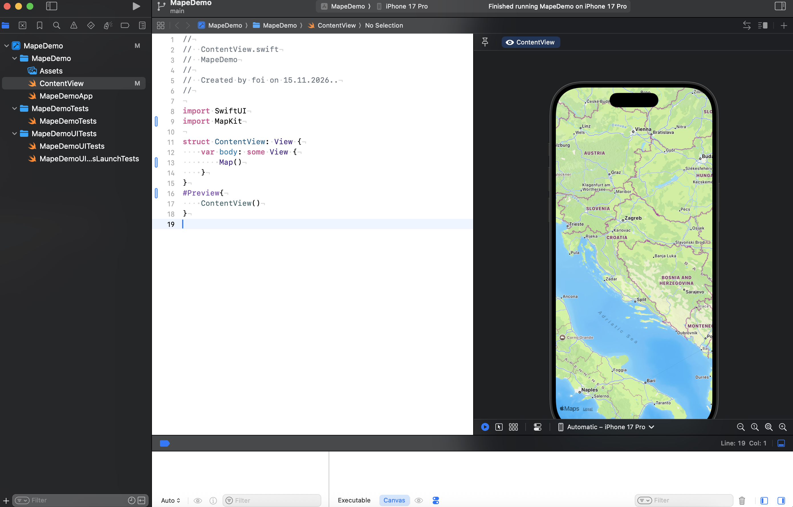
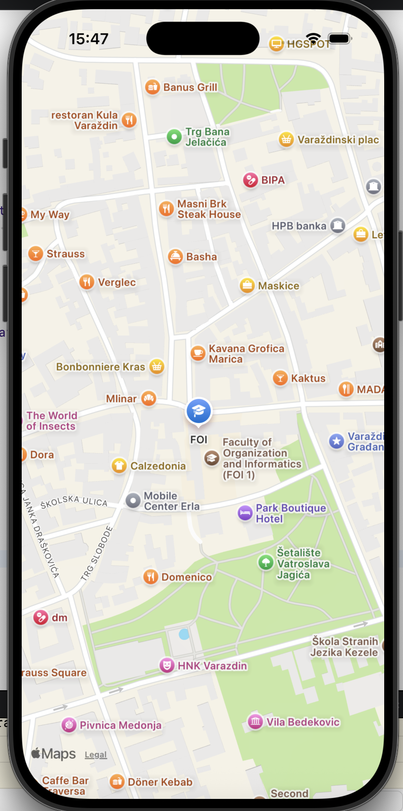
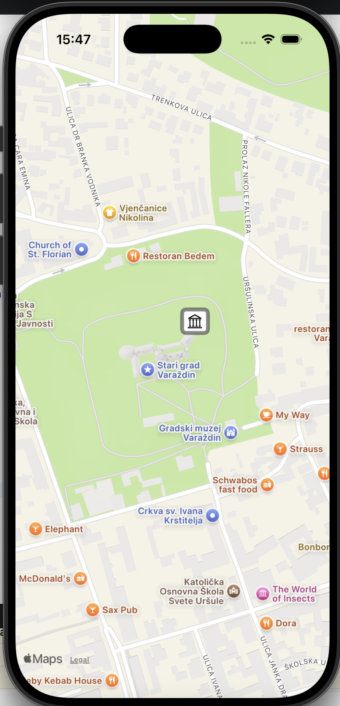
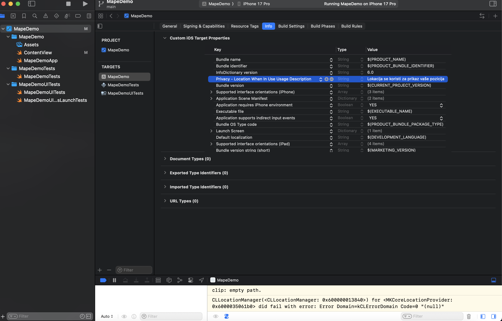
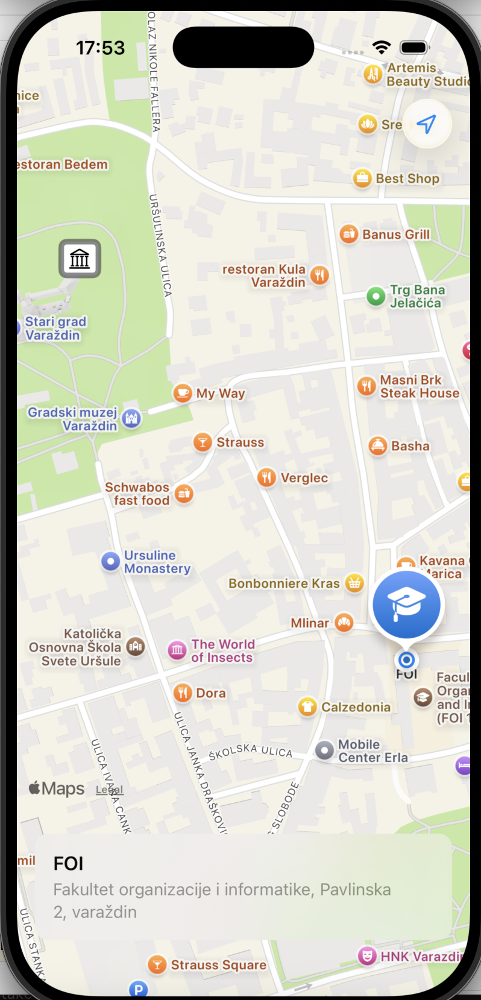
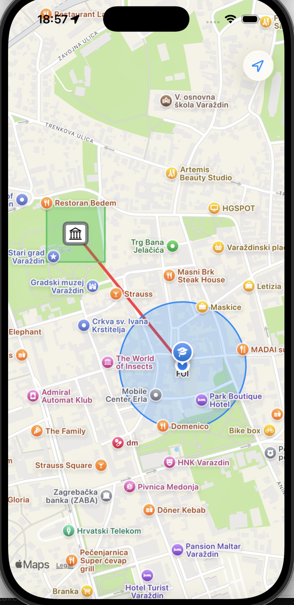
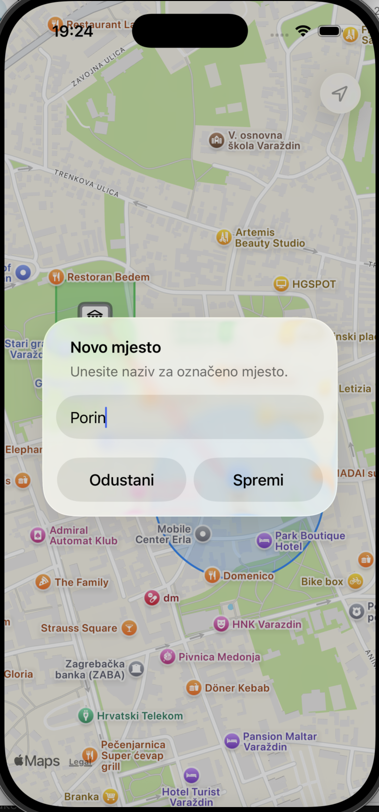
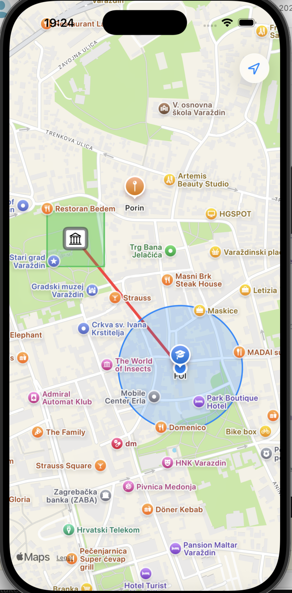

# Korištenje mapa u aplikaciji

Seminarski rad iz kolegija RAMPU

## Plan rada

Bavimo se izradom jednostavne iOS aplikacije koja će imati mogućnosti:
1. Prikaza mape/karte (MapKit for SwiftUI)
2. Traženje dozvole korisnika za korištenje njegove lokacije
3. Dodavanja POI-ja i drugih grafičkih elemenata na mapu/kartu (markeri, anotacije)
4. reagiranja na korsnikov klik kad klikne na elemente

Kod većinski prati službene Appleove materijale navedene u odjeljku [Literatura](#literatura).

## Koraci

| Korak | Sadržaj | Status |
|---|---|---|
| 1 | Prazan SwiftUI projekt i prikaz mape | dovršeno |
| 2 | Markeri i anotacije (POI) | dovršeno |
| 3 | Dozvola za lokaciju i prikaz korisnikove lokacije | dovršeno |
| 4 | Odabir (klik) na markere i prikaz detalja | dovršeno |
| 5 | Klik na proizvoljno mjesto na mapi (dodavanje vlastitog POI-ja) | ne dovršeno |

<br>

## Korak 1- Prazan SwiftUI projekt i prikaz mape

Da bi mogli prikazati mapu/kartu moramo koristiti Appleov framework MapKit, pošto smo stavili da je najmanja podrška iOS 17, MapKit ima potpuno podršku za SwiftUI pa je zbog toga dovoljno sam napisati jedan red koda: Map()

U ContentView.swift dodamo import MapKit te umjesto predloška s Hello world dodamo Map()

```swift
import SwiftUI
import MapKit

struct ContentView: View {
    var body: some View {
        Map()
    }
}
```
Import MapKit- služi da možemo koristiti mape i sve povezano s njima (Map, Marker, Annotation)
Map()- otvara interaktivnu mapu na kojoj korisnik može zumirat, kretat se i ostalo



<br>

## Korak 2- Markeri i anotacije (POI)

MapKit nudi dvije opcije označavanja: marker kojemu dajemo ime kordinate i ikonu te anotaciju kojoj dodajemo isto to, ali joj radimo izgled proizvoljno. U primjeru s slika napravljen je plavi marker na FOI i anotacija u obliku kvadratića na Stari grad. Kako bi ih mogli postaviti na pišemu unutar vitičastih zagrada nakon Map().
 
Lokacije smo napravili kao konstante u proširenju tipa CLLocationCoordinate2D te imamo .foi i .starigrad

```swift
extension CLLocationCoordinate2D {
    static let foi = CLLocationCoordinate2D(latitude: 46.3077, longitude: 16.3381)
    static let stariGrad = CLLocationCoordinate2D(latitude: 46.3105, longitude: 16.3348)
}
```

### Marker

```swift
Marker("FOI", systemImage: "graduationcap.fill", coordinate: .foi)
    .tint(.blue)
```

- "FOI" – natpis ispod markera
- systemImage: – ikona iz Appleove biblioteke SF Symbols
- .tint(.blue) – boja balona


### Annotation

```swift
Annotation("Stari grad", coordinate: .stariGrad) {
    ZStack {
        RoundedRectangle(cornerRadius: 5)
            .fill(.background)
        RoundedRectangle(cornerRadius: 5)
            .stroke(.secondary, lineWidth: 5)
        Image(systemName: "building.columns")
            .padding(5)
    }
}
.annotationTitles(.hidden)
```

- unutar { } pišemo vlastiti SwiftUI pogled – ovdje ZStack slaže pozadinu, okvir i ikonu jedno preko drugog
- .annotationTitles(.hidden) – skriva natpis ispod anotacije
  


<br>

## Korak 3- Dozvola za lokaciju i prikaz korisnikove lokacije

Pošto je lokacija osjetljiv podatak te ne želimo da svatko ima pristup njoj, Apple uvijek mora napraviti upit smije li joj pristupiti. Da bi to mogao napraviti potreban mu je framework Core Location.

Također je potrebno znati zbog čega aplikacija treba pristup našoj lokaciji. Da bi to mogli prikazati trebamo:
U Xcodeu: Targets → MapeDemo → Info → Custom iOS Target Properties → +

- ključ: Privacy - Location When In Use Usage Description (NSLocationWhenInUseUsageDescription)
- vrijednost: Lokacija se koristi za prikaz vašeg položaja na mapi.



<br>

### Upit

Kada se otvori upit imaju 3 opcije: Allow once, Allow while Using App, Dont allow. 


####  Traženje dozvole u kodu

```swift
struct ContentView: View {
    @State private var locationManager = CLLocationManager()

    var body: some View {
        Map {
            UserAnnotation()
            // ... Izostavljeni marker i anotacija iz koraka 2 radi lakše preglednosti
        }
        .mapControls {
            MapUserLocationButton()
            MapCompass()
            MapScaleView()
        }
        .onAppear {
            locationManager.requestWhenInUseAuthorization()
        }
    }
}
```

- CLLocationManager – Appleov objekt za upravljanje lokacijskim uslugama
- @State – čuva isti manager dok je ekran prikazan
- requestWhenInUseAuthorization() – prikazuje upit, ali ako je korisnik već odgovorio, ne prikazuje ništa
- UserAnnotation() – korisnikova lokacija kao plava točka
- .mapControls – kontrole: gumb za lokaciju, kompas i mjerilo

### Prikaz gumba za lokaciju, kompasa i mjerila:


<br>

### Zadavanje kordinata gdje se nalazimo preko simulatora

Pošto radimo na simulatora trebalo bi mu zadati neke kordinate gjde se "kao" nalazimo. To se radi tako da kad ste na simlatoru kliknete Features → Location → Custom Location… i upišete željene kordinate


## Korak 4- Odabir (klik) na markere i prikaz detalja

### Odabir

MapKit koristi selection za sve elemente mape na koje korisnik može kliknuti. MapKit sam obilježava koji je element odabran.

Postupak kako to napraviti:

1. napravimo varijablu u koju se sprema odabrani element,
2. povežemo je s mapom: Map(selection: $odabrano),
3. svaki element koji želimo kliknuti treba imati .tag(...),
4. na temelju vrijednosti varijable prikažemo detalje.

```swift
@State private var odabrano: String?

var body: some View {
    Map(selection: $odabrano) {
        Marker("FOI", systemImage: "graduationcap.fill", coordinate: .foi)
            .tint(.blue)
            .tag("FOI")

        Annotation("Stari grad", coordinate: .stariGrad) {
            // ... izgled anotacije iz koraka 2
        }
        .annotationTitles(.hidden)
        .tag("Stari grad")
    }
}
```
- String? – varijabla može biti prazna (nil) kad ništa nije odabrano
- $odabrano – mapa smije mijenjati vrijednost varijable
- .tag("FOI") – kad korisnik klikne element, u varijablu se upiše njegova oznaka, ako element nema .tag ne može se kliknuti
- klik na prazni dio mape poništava vrijednost u odabrano (odabrano postaje nil)

### Prikaz detalja

Kada odaberemo marker ili anotaciju dolje će nam se pokazati prozorčić s informacijom o markeru ili anotaciji.

```swift
.safeAreaInset(edge: .bottom) {
    if let odabrano {
        VStack(alignment: .leading, spacing: 4) {
            Text(odabrano)
                .font(.headline)
            Text(opis(naziv: odabrano))
                .font(.subheadline)
                .foregroundStyle(.secondary)
        }
        .frame(maxWidth: .infinity, alignment: .leading)
        .padding()
        .background(.background)
        .clipShape(RoundedRectangle(cornerRadius: 12))
        .shadow(radius: 5)
        .padding()
    }
}
```

```swift
func opis(naziv: String) -> String {
    switch naziv {
    case "FOI":
        return "Fakultet organizacije i informatike, Pavlinska 2, Varaždin"
    case "Stari grad":
        return "Srednjovjekovna utvrda, dio Gradskog muzeja Varaždin"
    default:
        return ""
    }
}
```

- .safeAreaInset(edge: .bottom)– dodaje prozorčić na dno ekrana, mapa ostaje vidljiva u pozadini
- if let odabrano – prozorčić će se prikazati samo ako je nesto kliknuto (ne prazna povrsina)
- .background(.background) – boja pozadine ovisno o temi
- opis(naziv:) – za naziv koji imamo vraća is switcha rezultat, tj. opis



## Korak 5- Klik na proizvoljno mjesto na mapi (dodavanje vlastitog POI-ja) i Grafički elementi

### Grafički elementi

Osim točaka (POI), na mapu možemo crtati i **područja i putanje**. MapKit nudi tri vrste overlaya:

MapCircle- pravi kružnicu oko odabrane točke
MapPolygon- zatvoreni geometrijski lik napravljen spajanjem točaka
MapPolyline- linija koja spaja dvije točke

```swift
let podrucjeStarogGrada = [
    CLLocationCoordinate2D(latitude: 46.3111, longitude: 16.3339),
    CLLocationCoordinate2D(latitude: 46.3111, longitude: 16.3357),
    CLLocationCoordinate2D(latitude: 46.3099, longitude: 16.3357),
    CLLocationCoordinate2D(latitude: 46.3099, longitude: 16.3339)
]
```

```swift
Map(selection: $odabrano) {
    MapCircle(center: .foi, radius: 150)
        .foregroundStyle(.blue.opacity(0.2))
        .stroke(.blue, lineWidth: 2)

    MapPolygon(coordinates: podrucjeStarogGrada)
        .foregroundStyle(.green.opacity(0.3))
        .stroke(.green, lineWidth: 2)

    MapPolyline(coordinates: [.foi, .stariGrad])
        .stroke(.red, lineWidth: 4)
}
```

- .foregroundStyle(...) – boja ispune, opacity(0.2) omogućuje da se mapa vidi kroz nju
- .stroke(...) – boja i debljina ruba / linije
- točke poligona spajaju se redom kojim su navedene, te se zadnja točka spaja s prvom točkom
- overlayje treba prije navesti kako bi se markeri napravili na njima



### Dodavanje POI-ja klikom na kartu

Uz pomoć MapReader možemo klikom na kartu, dobiti kordinate gdje smo kliknuli tako da dobijemo proxy metodom convert(_:from:).

Model dodanog mjesta:

```swift
struct DodanoMjesto: Identifiable {
    let id = UUID()
    let naziv: String
    let koordinata: CLLocationCoordinate2D
}
```

Stanje:

```swift
@State private var dodanaMjesta: [DodanoMjesto] = []
@State private var novaKoordinata: CLLocationCoordinate2D?
@State private var prikaziUnos = false
@State private var unesenoIme = ""
```

Prepoznavanje klika i pretvorba u koordinate:

```swift
MapReader { proxy in
    Map(selection: $odabrano) {
        // ...
        ForEach(dodanaMjesta) { mjesto in
            Marker(mjesto.naziv, systemImage: "mappin", coordinate: mjesto.koordinata)
                .tint(.orange)
                .tag(mjesto.naziv)
        }
    }
    .simultaneousGesture(
        DragGesture(minimumDistance: 0)
            .onEnded { vrijednost in
                let pomak = abs(vrijednost.translation.width) + abs(vrijednost.translation.height)

                if pomak < 5, let koordinata = proxy.convert(vrijednost.location, from: .local) {
                    novaKoordinata = koordinata
                    unesenoIme = ""
                    prikaziUnos = true
                }
            }
    )
}
```

Standardni pristup je .onTapGesture na mapi, no na iOS-u 26 se on na Map pogledu ne okida (problem prijavljen na Apple Developer Forumu). Zato se koristi DragGesture(minimumDistance: 0) kao drugo rješenje problema: ako se prst gotovo nije pomaknuo (pomak < 5), radi se o kliku, a ne o povlačenju mape. .simultaneousGesture omogućuje da pomicanje i zumiranje mape i dalje rade.

Unos naziva novog mjesta:

```swift
.alert("Novo mjesto", isPresented: $prikaziUnos) {
    TextField("Naziv mjesta", text: $unesenoIme)
    Button("Spremi") {
        if let novaKoordinata {
            let ime = unesenoIme.isEmpty ? "Mjesto \(dodanaMjesta.count + 1)" : unesenoIme
            dodanaMjesta.append(DodanoMjesto(naziv: ime, koordinata: novaKoordinata))
        }
    }
    Button("Odustani", role: .cancel) { }
} message: {
    Text("Unesite naziv za označeno mjesto.")
}
```

- klik na mapu zapamti koordinatu i otvori prozor za unos imena
- Spremi dodaje narančasti marker s napisanim imenom 
- Odustani zatvara prozor za dodavanje markera bez dodavanja
 
 


## Literatura

1. Apple Inc. (2023). *Meet MapKit for SwiftUI*. WWDC23, sesija 10043. https://developer.apple.com/videos/play/wwdc2023/10043/
2. Apple Inc. (2024). *What's new in location authorization*. WWDC24. https://developer.apple.com/videos/maps-location
3. Apple Inc. (2024). *Unlock the power of places with MapKit*. WWDC24, sesija 10097. https://developer.apple.com/videos/play/wwdc2024/10097/
4. Apple Inc. (2025). *Go further with MapKit*. WWDC25, sesija 204. https://developer.apple.com/videos/play/wwdc2025/204/
5. Apple Inc. *CLLocationManager*. Apple Developer Documentation. https://developer.apple.com/documentation/corelocation/cllocationmanager
6. Apple Inc. *requestWhenInUseAuthorization()*. Apple Developer Documentation. https://developer.apple.com/documentation/corelocation/cllocationmanager/requestwheninuseauthorization()
7. Apple Inc. *MapKit for SwiftUI*. Apple Developer Documentation. https://developer.apple.com/documentation/mapkit/mapkit-for-swiftui
8. Ahmad Sahar (2023). *iOS 17 Programming for Beginners* (8. izd.), poglavlje „Using MapKit for SwiftUI”. Packt Publishing.
