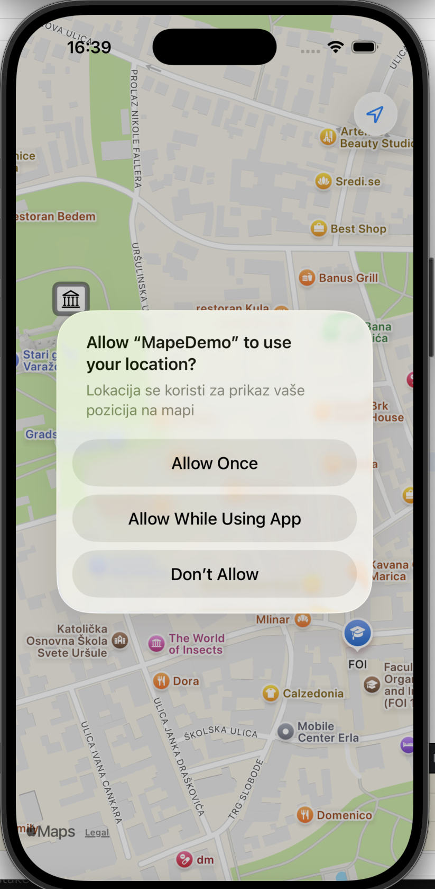
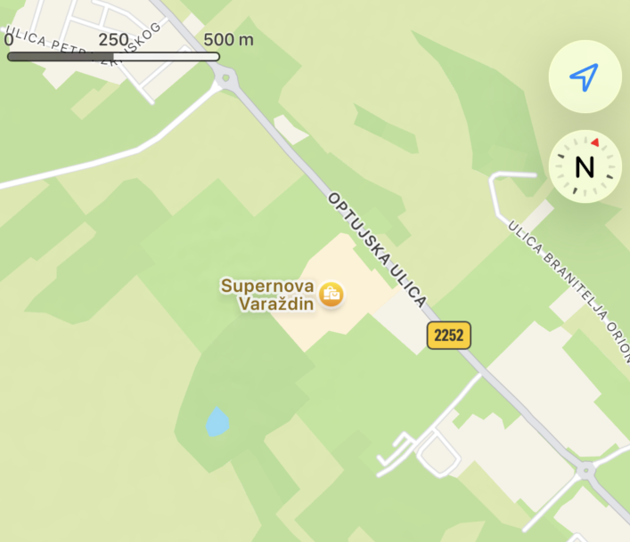

# Korištenje mapa u aplikaciji

Seminarski rad iz kolegija RAMPU

## Plan rada

Bavimo se izradom jednostavne iOS aplikacije koja će imati mogućnosti:
1. Prikaza mape/karte (MapKit for SwiftUI)
2. Traženje dozvole korisnika za korištenje njegove lokacije
3. Dodavanja POI-ja i drugih grafičkih elemenata na mapu/kartu (markeri, anotacije)
4. reagiranja na korsnikov klik kad klikne na elemente

Kod većinski prati službene Appleove materijale navedene u odjeljku [Literatura](#literatura).

## Koraci

| Korak | Sadržaj | Status |
|---|---|---|
| 1 | Prazan SwiftUI projekt i prikaz mape | dovršeno |
| 2 | Markeri i anotacije (POI) | dovršeno |
| 3 | Dozvola za lokaciju i prikaz korisnikove lokacije | dovršeno |
| 4 | Odabir (klik) na markere i prikaz detalja | ne dovršeno |
| 5 | Klik na proizvoljno mjesto na mapi (dodavanje vlastitog POI-ja) | ne dovršeno |

<br>

## Korak 1- Prazan SwiftUI projekt i prikaz mape

Da bi mogli prikazati mapu/kartu moramo koristiti Appleov framework MapKit, pošto smo stavili da je najmanja podrška iOS 17, MapKit ima potpuno podršku za SwiftUI pa je zbog toga dovoljno sam napisati jedan red koda: Map()

U ContentView.swift dodamo import MapKit te umjesto predloška s Hello world dodamo Map()

```swift
import SwiftUI
import MapKit

struct ContentView: View {
    var body: some View {
        Map()
    }
}
```
Import MapKit- služi da možemo koristiti mape i sve povezano s njima (Map, Marker, Annotation)
Map()- otvara interaktivnu mapu na kojoj korisnik može zumirat, kretat se i ostalo


<br>

## Korak 2- Markeri i anotacije (POI)

MapKit nudi dvije opcije označavanja: marker kojemu dajemo ime kordinate i ikonu te anotaciju kojoj dodajemo isto to, ali joj radimo izgled proizvoljno. U primjeru s slika napravljen je plavi marker na FOI i anotacija u obliku kvadratića na Stari grad. Kako bi ih mogli postaviti na pišemu unutar vitičastih zagrada nakon Map().
 
Lokacije smo napravili kao konstante u proširenju tipa CLLocationCoordinate2D te imamo .foi i .starigrad

```swift
extension CLLocationCoordinate2D {
    static let foi = CLLocationCoordinate2D(latitude: 46.3077, longitude: 16.3381)
    static let stariGrad = CLLocationCoordinate2D(latitude: 46.3105, longitude: 16.3348)
}
```

### Marker

```swift
Marker("FOI", systemImage: "graduationcap.fill", coordinate: .foi)
    .tint(.blue)
```

- "FOI" – natpis ispod markera
- systemImage: – ikona iz Appleove biblioteke SF Symbols
- .tint(.blue) – boja balona


### Annotation

```swift
Annotation("Stari grad", coordinate: .stariGrad) {
    ZStack {
        RoundedRectangle(cornerRadius: 5)
            .fill(.background)
        RoundedRectangle(cornerRadius: 5)
            .stroke(.secondary, lineWidth: 5)
        Image(systemName: "building.columns")
            .padding(5)
    }
}
.annotationTitles(.hidden)
```

- unutar { } pišemo vlastiti SwiftUI pogled – ovdje ZStack slaže pozadinu, okvir i ikonu jedno preko drugog
- .annotationTitles(.hidden) – skriva natpis ispod anotacije
  


<br>

## Korak 3- Dozvola za lokaciju i prikaz korisnikove lokacije

Pošto je lokacija osjetljiv podatak te ne želimo da svatko ima pristup njoj, Apple uvijek mora napraviti upit smije li joj pristupiti. Da bi to mogao napraviti potreban mu je framework Core Location.

Također je potrebno znati zbog čega aplikacija treba pristup našoj lokaciji. Da bi to mogli prikazati trebamo:
U Xcodeu: Targets → MapeDemo → Info → Custom iOS Target Properties → +

- ključ: Privacy - Location When In Use Usage Description (NSLocationWhenInUseUsageDescription)
- vrijednost: Lokacija se koristi za prikaz vašeg položaja na mapi.


<br>

### Upit

Kada se otvori upit imaju 3 opcije: Allow once, Allow while Using App, Dont allow. 



####  Traženje dozvole u kodu

```swift
struct ContentView: View {
    @State private var locationManager = CLLocationManager()

    var body: some View {
        Map {
            UserAnnotation()
            // ... Izostavljeni marker i anotacija iz koraka 2 radi lakše preglednosti
        }
        .mapControls {
            MapUserLocationButton()
            MapCompass()
            MapScaleView()
        }
        .onAppear {
            locationManager.requestWhenInUseAuthorization()
        }
    }
}
```

- CLLocationManager – Appleov objekt za upravljanje lokacijskim uslugama
- @State – čuva isti manager dok je ekran prikazan
- requestWhenInUseAuthorization() – prikazuje upit, ali ako je korisnik već odgovorio, ne prikazuje ništa
- UserAnnotation() – korisnikova lokacija kao plava točka
- .mapControls – kontrole: gumb za lokaciju, kompas i mjerilo

### Prikaz gumba za lokaciju, kompasa i mjerila:



<br>

### Zadavanje kordinata gdje se nalazimo preko simulatora

Pošto radimo na simulatora trebalo bi mu zadati neke kordinate gjde se "kao" nalazimo. To se radi tako da kad ste na simlatoru kliknete Features → Location → Custom Location… i upišete željene kordinate


## Literatura

1. Apple Inc. (2023). *Meet MapKit for SwiftUI*. WWDC23, sesija 10043. https://developer.apple.com/videos/play/wwdc2023/10043/
2. Apple Inc. (2024). *What's new in location authorization*. WWDC24. https://developer.apple.com/videos/maps-location
3. Apple Inc. (2024). *Unlock the power of places with MapKit*. WWDC24, sesija 10097. https://developer.apple.com/videos/play/wwdc2024/10097/
4. Apple Inc. (2025). *Go further with MapKit*. WWDC25, sesija 204. https://developer.apple.com/videos/play/wwdc2025/204/
5. Apple Inc. *CLLocationManager*. Apple Developer Documentation. https://developer.apple.com/documentation/corelocation/cllocationmanager
6. Apple Inc. *requestWhenInUseAuthorization()*. Apple Developer Documentation. https://developer.apple.com/documentation/corelocation/cllocationmanager/requestwheninuseauthorization()
7. Apple Inc. *MapKit for SwiftUI*. Apple Developer Documentation. https://developer.apple.com/documentation/mapkit/mapkit-for-swiftui
8. Ahmad Sahar (2023). *iOS 17 Programming for Beginners* (8. izd.), poglavlje „Using MapKit for SwiftUI”. Packt Publishing.
